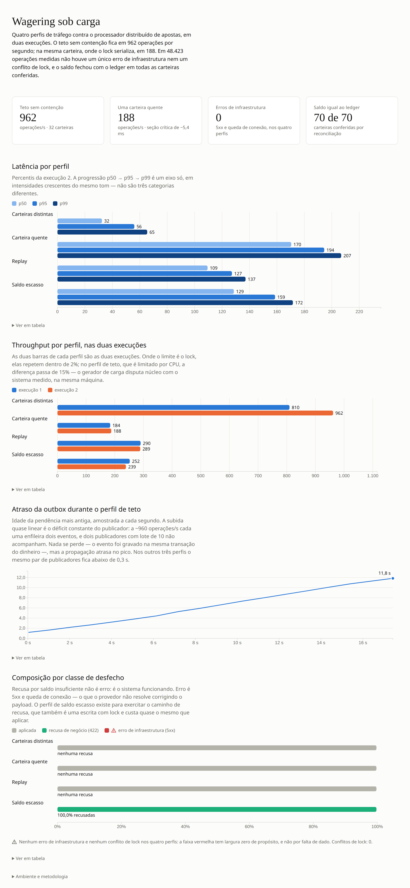

# Distributed Wagering Processor

Serviço financeiro distribuído que processa transações de apostas de múltiplos provedores de jogos, por HTTP e por fila, com entrega *at-least-once*.

Desafio técnico Jungle Gaming. As decisões de arquitetura e seus trade-offs estão em [`ARCHITECTURE.md`](./ARCHITECTURE.md).

> **Estado atual: API HTTP completa.** Domínio, schema, persistência, use cases e API estão prontos. Os workers (consumer SQS, publisher da outbox, reprocessamento de referência) e a autenticação chegam nas fases seguintes — ver `ARCHITECTURE.md`.

## Requisitos

| Ferramenta | Versão |
|---|---|
| [Bun](https://bun.sh) | 1.4+ |
| Docker + Compose | Compose v2+ |

Instalar o Bun: `curl -fsSL https://bun.sh/install | bash`

## Setup

```bash
cp .env.example .env     # os defaults já apontam para o Compose
bun install
bun run compose:up       # build, aplica as migrations e sobe a stack inteira
```

O `compose:up` sobe um serviço `migrate` que aplica as migrations e sai; API, consumer e workers só iniciam depois que ele termina com sucesso. É serviço próprio, e não migration no boot da aplicação, porque três réplicas de API subindo juntas disputariam a mesma migration — e evoluir schema não é trabalho de um worker de fila.

Conferir que está de pé:

```bash
curl -s localhost:3001/health/ready | jq
curl -s localhost:3002/health/live  | jq
```

Derrubar tudo, inclusive os volumes:

```bash
bun run compose:down
```

## Portas

| Serviço | Porta | Observação |
|---|---|---|
| `api-1` / `api-2` / `api-3` | 3001 / 3002 / 3003 | três instâncias, para exercitar concorrência real |
| `consumer` | 3011 | só `/metrics` e health checks |
| `outbox-1` / `outbox-2` | 3012 / 3013 | só `/metrics` e health checks |
| `reference` | 3014 | só `/metrics` e health checks |
| PostgreSQL | 5433 | `wagering` / `wagering` / db `wagering`. 5433 no host porque a 5432 costuma estar ocupada; dentro da rede do Compose é 5432 |
| LocalStack (SQS) | 4566 | filas criadas no boot pelo init script |
| Keycloak | 8080 | admin `admin` / `admin`, realm `jungle` |

## Comandos

| Comando | O que faz |
|---|---|
| `bun run dev` | API local em watch mode |
| `bun run typecheck` | `tsc --noEmit` em modo estrito |
| `bun run db up` | aplica as migrations pendentes |
| `bun run db down` | reverte a última migration |
| `bun run db create <nome>` | cria uma migration versionada e vazia |
| `bun run db list` | o que está aplicado e o que está pendente |
| `bun run db fresh --yes` | dropa o schema e reaplica tudo. Destrutivo: exige `--yes` e é bloqueado em produção |
| `bun test` | suíte completa |
| `bun run test:unit` | só unidade — sem container, sem rede |
| `bun run test:integration` | PostgreSQL e LocalStack reais |
| `bun run test:concurrency` | corridas com processos de verdade |
| `bun run test:load` | teste de carga e seu relatório |
| `bun run compose:logs` | logs de todos os serviços |

Os testes de integração e concorrência precisam da stack no ar (`bun run compose:up`).

### Testes de concorrência

`bun run test:concurrency` sobe **processos Bun de verdade** — não `Promise.all` no mesmo event loop — e os alinha numa barreira TCP antes de disparar. Sem a barreira, a diferença de tempo de inicialização entre os filhos serializaria as operações e o teste passaria com código errado.

| Cenário | O que prova |
|---|---|
| Saldo 100, duas apostas de 80 | uma `PROCESSED`, uma `REJECTED`, saldo 20, **um** débito |
| Três e quatro processos na mesma carteira | só o saldo disponível sai, e ninguém recebe erro cru de concorrência |
| 50 submissões da mesma chave (5 processos × 10) | um único débito, 49 replays do mesmo `transactionId` |
| Quatro carteiras em paralelo | nenhuma recusa: a unidade de concorrência é a carteira |
| Worker morto com `SIGKILL` depois do commit, antes do ack | a reentrega não duplica o efeito — a inbox commitou junto com o dinheiro |
| Reinício no meio de quatro mensagens | quatro efeitos, nunca cinco |
| Dois publishers na mesma outbox | a soma do que os dois publicaram é exatamente o que havia pendente |
| `REFUND` e `ROLLBACK` da mesma `BET`, juntos | uma credita, a outra recebe `REFERENCE_ALREADY_REVERSED` |
| `ROLLBACK` e a `BET` ao mesmo tempo | o saldo final não depende de quem chegou primeiro |
| Duas réplicas do worker de referência no mesmo ciclo | uma única tentativa consumida, o backoff continua valendo |

Todo teste fecha com a mesma invariante: `wallet.balance` igual ao saldo reconstruído somando o ledger.

O próprio harness é testado: um processo filho que morre antes da largada derruba a corrida em segundos, com o `stderr` dele na mensagem, em vez de pendurar o arquivo até o timeout do runner.

### Isolamento da suíte

Os testes rodam contra um **banco e filas próprios** — `wagering_test` e as filas com sufixo `-test`. O `bun test` define `NODE_ENV=test`, e o Bun carrega o [`.env.test`](./.env.test) por cima do `.env`.

Isso não é higiene opcional: os workers do Compose (`consumer`, `outbox-1`, `outbox-2`) ficam vivos durante os testes e, sem o isolamento, competem por eles — roubam mensagens da fila e publicam linhas da outbox que o teste espera encontrar pendentes. O sintoma é falha intermitente que não reproduz quando o arquivo roda isolado.

O banco de teste é criado automaticamente quando o volume do Postgres nasce. Num volume que já existe:

```bash
docker compose exec postgres psql -U wagering -d postgres \
  -c "create database wagering_test owner wagering"
```

## API

### Carteiras

```http
POST /wallets
```

```json
{ "playerId": "0192f28f-5dc0-7d58-bdb2-814ad6a0f4a1",
  "initialBalance": { "amount": "1000.00", "currency": "BRL" } }
```

Saldo inicial maior que zero gera uma transação interna `OPENING` com lançamento `CREDIT` **na mesma transação SQL**. `version` fica em `1`: a abertura é a criação, não uma movimentação.

```http
GET  /wallets/:walletId
GET  /wallets/:walletId/ledger?cursor=...&limit=50
POST /wallets/:walletId/reconciliation
```

O `cursor` é opaco e estável sobre `(created_at, id)` — nunca `OFFSET`, que pula ou repete linha quando a tabela recebe insert durante a paginação. `limit` aceita de 1 a 200.

A reconciliação **não corrige** divergência: se os dois lados discordam, não se sabe qual está certo, e corrigir destruiria a evidência do bug. Ela loga, sinaliza `consistent: false` e deixa a decisão para um humano.

### Transações

```http
POST /wagering/transactions
Idempotency-Key: provider-a:transaction-123
```

```json
{ "providerId": "provider-a",
  "externalTransactionId": "transaction-123",
  "playerId": "0192f28f-5dc0-7d58-bdb2-814ad6a0f4a1",
  "walletId": "0192f291-27dd-7d3f-8071-5f8685deef37",
  "roundId": "round-987",
  "gameId": "fortune-chimp",
  "kind": "BET",
  "money": { "amount": "25.00", "currency": "BRL" } }
```

O header `Idempotency-Key` é **obrigatório** — é a fonte da verdade da idempotência, e aceitar sem ele seria aceitar uma operação sem identidade.

```http
GET /wagering/transactions/:transactionId
GET /providers/:providerId/wagering/transactions/:externalTransactionId
```

### Mapa de status

| Situação | Status | Corpo |
|---|---|---|
| Aplicada, ou replay da aplicação original | `200` | `transactionId`, `status`, `balance`, `idempotentReplay` |
| Aceita, aguardando a referência chegar | `202` | `status: PENDING_REFERENCE` |
| Carteira criada | `201` | a carteira |
| Payload inválido | `400` | `error: INVALID_PAYLOAD`, `retryable: false` |
| Conflito de idempotência, operação duplicada, carteira duplicada | `409` | `error` nomeando o conflito |
| Rejeição por regra de negócio | `422` | `failureCode` |
| Falha transitória de infraestrutura | `503` + `Retry-After` | `retryable: true` |

O que está em jogo aqui: colapsar essas situações num código só obriga o provedor a interpretar mensagem de erro para decidir se pode reenviar. Essa é a diferença entre uma integração que se recupera sozinha e uma que gera ticket.

`422` e não `400` na rejeição de negócio porque a requisição estava **bem formada e foi compreendida** — foi o domínio que disse não.

### Correlação

Todo endpoint aceita `X-Correlation-Id` e o devolve na resposta. Se o cliente não mandar, um é gerado. O id atravessa HTTP, outbox, SQS e consumer: sem ele, investigar um incidente financeiro é costurar logs de três sistemas sem ligação entre eles.

## Health checks

```http
GET /health/live     # o processo está vivo — não consulta dependência externa
GET /health/ready    # PostgreSQL, schema aplicado e SQS, com latência de cada probe
```

Os dois são abertos, sem autenticação: readiness precisa responder mesmo com o Keycloak fora.

Os workers (`consumer`, `outbox`, `reference`) servem os health checks e `/metrics`, e nenhum endpoint de negócio. O healthcheck deles no Compose usa `/health/live`: readiness responde "posso receber tráfego do balanceador", pergunta que não se aplica a quem não recebe tráfego.

`/health/ready` devolve `200` quando tudo responde e `503` quando alguma probe falha, sempre com o detalhe de cada uma:

```json
{
  "status": "ok",
  "probes": [
    { "name": "postgres", "ok": true, "latencyMs": 2 },
    { "name": "schema",   "ok": true, "latencyMs": 5 },
    { "name": "sqs",      "ok": true, "latencyMs": 11 }
  ]
}
```

**Banco alcançável não é banco pronto.** A probe `schema` falha enquanto houver migration pendente, nomeando quais: sem ela, uma instância apontada para um banco sem schema respondia `200 ready` e só quebrava na primeira operação de negócio, com `500`.

## Autenticação

Desligada por default (`AUTH_ENABLED=false`) para o avaliador exercitar a API sem obter token. Com `AUTH_ENABLED=true`, os endpoints de negócio (`/wallets`, `/wagering/transactions`, `/providers/...`) exigem `Authorization: Bearer <JWT>` do Keycloak. Health checks e `/metrics` continuam abertos.

```bash
# Token de provedor, por client credentials
TOKEN=$(curl -s -X POST http://localhost:8080/realms/jungle/protocol/openid-connect/token \
  -d grant_type=client_credentials -d client_id=provider-a -d client_secret=provider-a-secret \
  | python3 -c 'import sys,json;print(json.load(sys.stdin)["access_token"])')

curl -H "Authorization: Bearer $TOKEN" http://localhost:3001/wallets/<walletId>
```

O realm `jungle` já vem com dois clients de serviço — `provider-a` e `provider-b` —, cada um com a claim `providerId` e a audience `wagering-api`. **Os segredos no realm são de desenvolvimento**, versionados para o Compose subir sozinho; em produção não existiriam no repositório.

| Resposta | Quando |
|---|---|
| `401 MISSING_TOKEN` | sem header, ou header que não é `Bearer <token>` |
| `401 INVALID_TOKEN` | assinatura, issuer, audience, expiração ou claim `providerId` |
| `403 PROVIDER_MISMATCH` | o `providerId` do corpo não é o do token |
| `403 IDEMPOTENCY_KEY_NOT_OWNED` | a `Idempotency-Key` não é do espaço do provedor do token |
| `404 TRANSACTION_NOT_FOUND` | transação de outro provedor — 403 confirmaria que ela existe |

O motivo da recusa fica no log do servidor, nunca na resposta: distinguir "assinatura inválida" de "audience errada" daria a quem forja um token o retorno de que ele precisa.

Os endpoints de carteira exigem token mas **não** são escopados por provedor: a carteira é do jogador e compartilhada entre provedores, então o extrato dela contém operações de vários. É limitação consciente, registrada no `ARCHITECTURE.md`.

## Observabilidade

### Logs

JSON estruturado em stdout, uma linha por submissão, com os campos de correlação:

```json
{"level":"info","time":"2026-11-11T11:06:22.289Z","role":"api","pid":1,
 "correlationId":"fb160c24-…","transactionId":"01a1ca49-…","walletId":"01a1ca49-…",
 "providerId":"provider-a","externalTransactionId":"external-a226…",
 "kind":"BET","source":"API","outcome":"PROCESSED","durationMs":4,
 "msg":"transacao submetida"}
```

Valor monetário é redigido (`money`, `balance`, `amount`, `payload`, `initialBalance`, `difference` e os mesmos campos um nível abaixo viram `[redigido]`). Mensagem de erro de domínio **não** é logada, porque cita o valor submetido e a redação age sobre campo, não sobre texto dentro de string — o nome da classe do erro e o `failureCode` ficam no lugar dela.

O log do Nest e o do MikroORM também passam pelo pino, então **toda** linha do processo é JSON. Cada linha leva `hostname` (em container, o id), que é o que distingue as três réplicas de API.

`LOG_LEVEL` aceita `trace|debug|info|warn|error|silent`. `silent` existe para a suíte de teste.

### Métricas

```http
GET /metrics     # formato texto do Prometheus, sem auth, em todos os papéis
```

| Série | Tipo | Labels |
|---|---|---|
| `wager_transactions_total` | counter | `outcome`, `kind`, `source`, `failure_code` |
| `wager_transaction_duration_seconds` | histograma | `outcome`, `source` |
| `wager_duplicates_total` | counter | `kind` (`idempotency_replay`, `idempotency_conflict`, `external_transaction`, `inbox_message`) |
| `wager_retries_total` | counter | `subject` (`queue_message`, `outbox_event`, `reference_resolution`) |
| `wager_dead_letter_total` | counter | `reason` (`invalid_envelope`, `permanent_failure`, `delivery_limit`) |
| `wager_lock_conflicts_total` | counter | `reason` (`deadlock`, `serialization`, `version_mismatch`) |
| `wager_reconciliation_divergences_total` | counter | — |
| `wager_outbox_lag_seconds` | gauge | — · **só no papel `outbox`** |

Todas carregam `role` (`api`, `consumer`, `outbox`, `reference`) como label default, mais as métricas de processo do `prom-client`.

Um replay idempotente conta em `wager_duplicates_total`, **não** em `wager_transactions_total`: a série precisa fechar com o ledger. Pelo mesmo motivo, as transações aplicadas pelo worker de referência e o `OPENING` da abertura de carteira entram na série. Payload inválido conta como `outcome="INVALID"`, separado de `ERROR`, que é falha do sistema.

`wager_outbox_lag_seconds` só aparece no processo que publica a outbox: um gauge registrado nasce em zero, e exportá-lo nos outros papéis faria um alerta em `avg`/`min` sobre publisher parado ler ~0.

Nenhum valor monetário aparece em label ou em valor de série.

```bash
curl -s localhost:3001/metrics | grep wager_transactions_total
curl -s localhost:3012/metrics | grep wager_outbox_lag_seconds
```

## Consumer SQS

O serviço `consumer` do Compose consome `wager-transactions.fifo` e **reutiliza o mesmo use case da entrada HTTP** — duas implementações da mesma regra financeira divergem na primeira correção aplicada num caminho e esquecida no outro.

| Comportamento | Como |
|---|---|
| Deduplicação | inbox persistente por `(consumerName, messageId)`, usando o `messageId` do **envelope** (identidade no provedor), não o id do broker — que muda quando o provedor reenvia |
| `ack` | **somente após o commit**. Dar ack antes é perder a mensagem se o processo morrer com trabalho não confirmado |
| Erro de negócio | commita a rejeição e dá ack. Reenviar não muda o resultado; manter na fila é loop infinito |
| Erro transitório | sem ack, devolve a visibilidade com espera curta. No limite de entregas, deixa o redrive do broker agir |
| Erro permanente | vai **direto** para a DLQ com o motivo em atributo, em vez de gastar cinco entregas inúteis |
| `SIGTERM` | drena: para de buscar, espera as mensagens em andamento, e devolve a visibilidade das que chegaram depois do pedido de parada |

Ver o drain acontecendo:

```bash
docker compose logs -f consumer &
docker compose stop -t 40 consumer
```

## Worker de referência ausente

O serviço `reference` reprocessa as transações em `PENDING_REFERENCE`.

Referência ausente **não é rejeição**: com entrega *at-least-once* e sem ordenação garantida, um `ROLLBACK` chegar antes da `BET` é comportamento normal. Rejeitar ali deixaria o provedor achando que reverteu enquanto nosso saldo diz que não — divergência financeira com o provedor, que é o pior resultado possível.

| Política | Valor |
|---|---|
| Backoff | 1s, 2s, 4s… saturando em **15 min** |
| Tentativas | 120 (rede de segurança) |
| TTL | **24h** — é ele que decide |

Os dois precisam ser coerentes: com o backoff saturado em 15 min, as 120 tentativas cobrem cerca de 28h, então o TTL vence primeiro. Há teste fixando essa relação, porque a primeira versão tinha 15 tentativas que esgotavam em ~38 min e tornavam o TTL decorativo.

Esgotado o limite, a transação é rejeitada com `REFERENCE_NOT_FOUND` e o evento correspondente é publicado, para o provedor conciliar do lado dele.

**Ordem de lock.** O worker trava a **carteira antes** da transação, a mesma ordem que o `SubmitWagerTransaction` usa. Ordens opostas entre dois escritores formam ciclo de deadlock — foi assim que uma versão anterior deste código produziu 28 deadlocks em 30 execuções.

Por causa dessa ordem, a fila é lida **sem claim**: reivindicar com `FOR UPDATE SKIP LOCKED` na transação exigiria travá-la antes da carteira. Quem serializa réplicas é a releitura sob o lock da carteira, que confere estado **e vencimento** com o relógio do banco — duas réplicas podem ler a mesma linha, mas a que chega depois do commit da primeira desiste sem consumir tentativa.

## Publisher da outbox

Os serviços `outbox-1` e `outbox-2` publicam os eventos pendentes. **Duas réplicas de propósito**: o `SKIP LOCKED` e o lease existem justamente para publishers concorrentes, e rodar um só não exercitaria nada disso.

O ciclo é deliberadamente em três etapas, com a publicação **fora** de transação:

1. reivindica com `FOR UPDATE SKIP LOCKED` e grava lease — transação curta;
2. publica no broker — nenhuma transação aberta;
3. marca publicada ou agenda retry — transação curta.

A alternativa seria manter a transação aberta durante o envio: não haveria publicação duplicada, mas o tempo de vida de um lock e de uma conexão de banco ficaria amarrado à latência de um terceiro — uma chamada pendurada ao SQS viraria uma transação pendurada, atrasando vacuum e consumindo pool.

Morrer entre as etapas 2 e 3 deixa o lease expirar, outro publisher reivindica e publica de novo. **Publicação duplicada é tolerada por desenho** — o consumidor deduplica pelo `eventId`, que é também o `MessageDeduplicationId` no broker.

Ver os dois publishers dividindo o trabalho:

```bash
docker compose logs -f outbox-1 outbox-2
```

A métrica que importa monitorar aqui é o **outbox lag** — a idade da pendência mais antiga. É o sintoma direto da única falha silenciosa deste desenho: o dinheiro está correto no banco, a API responde 200, e o mundo externo não está sendo avisado porque o publisher morreu.

## Filas

| Fila | Papel |
|---|---|
| `wager-transactions.fifo` | entrada de operações; `maxReceiveCount` 5 |
| `wager-transactions-dlq.fifo` | dead-letter da entrada |
| `wager-events.fifo` | eventos de integração publicados pela outbox |
| `wager-events-dlq.fifo` | dead-letter dos eventos |

O enunciado define as duas primeiras. As de eventos existem porque os eventos publicados pela outbox precisam de um destino — `MessageGroupId` é a `walletId`, preservando a ordem relativa dos eventos de uma mesma conta.

Criadas automaticamente quando o LocalStack fica pronto, por `docker/localstack/init-queues.sh`. O script é idempotente, então reiniciar o container não quebra nada.

## Teste de carga

Diferencial opcional. Exige o stack de pé (`bun run compose:up`):

```bash
bun run test:load
# configurável: LOAD_CONCURRENCY, LOAD_DURATION_SECONDS, LOAD_WARMUP_SECONDS,
#               LOAD_API_URLS, LOAD_PUBLISHER_URLS
```

Gera carga nas três instâncias de API alternadamente, sem balanceador, e salva o relatório bruto em `test/load/resultados/`. Dois relatórios estão versionados — são as duas execuções que embasam os números abaixo.

**Ambiente medido:** Intel Core 7 240H, 16 núcleos, 31 GB · Bun 1.4.4 · Docker 29.9.2 · `postgres:16-alpine` · `localstack/localstack:3` · 3 instâncias de API, 2 publishers, 1 consumer, 1 worker de referência — todos na mesma máquina do gerador de carga, que portanto disputa CPU com o sistema medido. Os números são piso, não teto.



*As quatro figuras acima são o relatório renderizado a partir dos dois arquivos de resultado versionados em `test/load/resultados/`.*

**Metodologia:** laço fechado com 32 trabalhadores; 3 s de aquecimento descartado e 15 s de medição por perfil; percentil por rank mais próximo, sem interpolação; saldo pré-provisionado para que recusa de negócio não seja confundida com erro; a outbox é drenada **entre** perfis, para que o atraso reportado seja o que aquele perfil gerou. Recusa por saldo (`422`) não conta como erro — erro é 5xx e queda de conexão. Cada perfil termina conferindo, pela reconciliação real, que o saldo de toda carteira usada fecha com o ledger.

| Perfil | ops/s | p50 | p95 | p99 | Erro infra | Conflitos de lock | Outbox lag (pico) | Saldo = ledger |
|---|---|---|---|---|---|---|---|---|
| Carteiras distintas (32 carteiras) | 810 – 962 | 32–38 ms | 56–68 ms | 65–81 ms | 0% | 0 | 9,2 – 11,8 s | 32/32 |
| Carteira quente (1 carteira) | 184 – 188 | 170–172 ms | 194–215 ms | 207–254 ms | 0% | 0 | 0,2 – 0,3 s | 1/1 |
| Replay (mesma chave) | 289 – 290 | 109 ms | 127 ms | 137–141 ms | 0% | 0 | 0 s | 1/1 |
| Saldo escasso (recusa) | 239 – 252 | 126–129 ms | 145–159 ms | 153–172 ms | 0% | 0 | 0,2 s | 1/1 |

### Análise

**Reprodutibilidade diz onde está o gargalo.** Os perfis limitados pelo lock da carteira repetem dentro de 2% entre execuções (184/188 e 289/290 ops/s); o perfil de teto oscila 17% (810/962). A diferença é o próprio método: quando o limite é a seção crítica no banco, o número é estável; quando é CPU, o gerador de carga disputa os mesmos núcleos do sistema medido e a medição fica barulhenta. Em bancada dedicada, o teto seria maior e menos variável — a contenção, igual.

**A latência sob contenção é fila, não lentidão.** Na carteira quente, 32 trabalhadores dividindo ~186 ops/s dão ~172 ms de permanência média por Little's law; o p50 medido foi 170–172 ms. O mesmo casa nos quatro perfis dentro de 3%. O tempo serializado por operação sai em ~5,4 ms: é o tamanho da seção crítica, e é ele que define o teto de **uma** carteira.

**O núcleo financeiro não errou uma vez.** Zero 5xx, zero conflito de lock, zero violação de versão em ~46 mil operações nas duas execuções. E a afirmação não depende de ninguém ter recebido erro: cada perfil fecha com a reconciliação conferindo que `saldo == soma do ledger` em toda carteira que ele tocou — perda de dinheiro sob carga não devolve 5xx, devolve 200 com o saldo errado.

**O gargalo de propagação aparece só no perfil de teto.** A 810–962 ops/s, cada operação enfileira dois eventos: ~1.900 eventos/s contra dois publishers com lote de 10, e o atraso chega a 11,8 s. A 186 ops/s o mesmo par de publishers fica em 0,2 s. Nada se perde — o evento commitou junto com o dinheiro —, e a correção é configuração, não desenho: lote maior e mais publishers, que é exatamente o que o `SKIP LOCKED` com lease permite escalar.

**O replay não escreve na outbox**, e isso aparece: 0 s de atraso no perfil. Ele é 1,5× o throughput da carteira quente (290 contra 186), mas ainda adquire o lock da carteira, porque o lock vem **antes** da checagem de idempotência — escolha feita para ter uma única seção crítica e evitar a elevação de lock que gerava deadlock. Responder replay pelo `observed_balance` da própria linha, sem lock, é a otimização óbvia e está registrada como trabalho futuro.

**Recusar custa quase o mesmo que aplicar** (245 contra 186 ops/s): a transação `REJECTED` também é persistida, então o caminho de recusa é uma escrita com lock, não um atalho.

## Estrutura

```
src/
  domain/           TypeScript puro — sem NestJS, sem ORM, sem SQS
  application/      casos de uso e portas
  infrastructure/   MikroORM, SQS, HTTP, observabilidade, Keycloak
test/
  unit/             sem infraestrutura
  integration/      PostgreSQL e LocalStack reais em containers
  concurrency/      múltiplos processos Bun, com barreira de largada
  load/             teste de carga
```

A fronteira do `src/domain/` é verificável: `grep -rE "@nestjs/|@mikro-orm/" src/domain` precisa voltar vazio.
